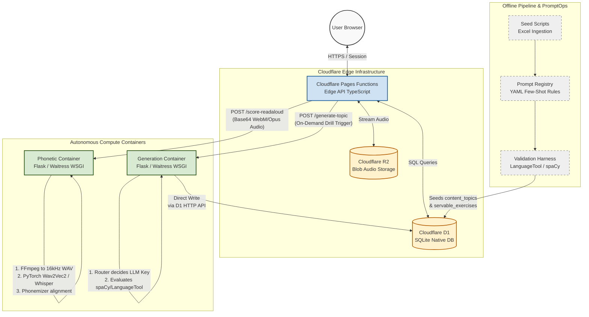
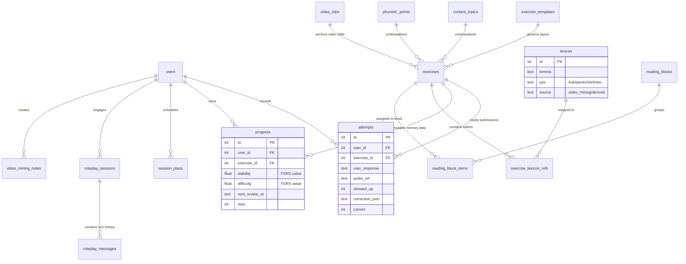

# App de Alemao B2/C1+ (uso pessoal)
## 🏗️ System Architecture & Data Flow



### 🗄️ Database Entity-Relationship Diagram (ERD)

To visualize how your database handles multi-user states, FSRS repetition loops, and semantic references, paste this **Database ERD** into your **`README.md`** right below the architecture section:

```markdown
### 📊 Database Relationships (Schema Schema)


```

---

### 💡 The Tech Lead Pitch For Your Portfolio
Once you commit these diagrams into your `README.md`, you can speak confidently in technical interviews like this:
> *"I designed the application boundaries around the physical limitations of serverless environments. Cloudflare Workers handle global entry routing, basic static validation, and sub-millisecond FSRS space-repetition logic. Because PyTorch, raw FFmpeg file conversions, and language validation models break Worker isolate bounds, I containerised them into dedicated Python Waitress WSGI services. The architecture utilizes decoupled sync states, allowing the Core Worker to hold global multi-user transactional records, while asynchronous container tasks speak natively via REST APIs."*

<FollowUp>
Now that your architectural roadmap is permanently documented, what should we tackle to ready this for your portfolio?
1. We can write a automated **GitHub Actions Workflow (`.github/workflows/verify-pipeline.yml`)** that verifies code formatting and runs your new vulture/depcheck whitelists on push.
2. We can build the **PromptOps folder structure** and refactor your system prompts into modular configuration files.
</FollowUp>

Comece lendo `CLAUDE.md` — e o resumo executivo de todas as decisoes ja tomadas.
Para o raciocinio completo por tras de cada decisao, ver `docs/`:

- `docs/01-plano-arquitetura.md` — arquitetura, gargalos, plano de acao original.
- `docs/02-mapeamento-planilhas.md` — o que cada planilha real e, e o mapeamento de ferramentas por tipo de exercicio.
- `docs/03-fundamentacao-comportamental.md` — como o design se conecta ao perfil e as tecnicas baseadas em evidencia.
- `docs/04-prompt-inicial-claude-code.md` — prompt pronto pra colar no Claude Code e comecar a Fase 0.
- `docs/05-engines-por-exercicio.xlsx` — as 118 atividades (103 da planilha original + 10 do bloco de leitura/noticia + 5 de fonetica/fala), cada uma como unidade de engine/modulo: mecanismo, stack, interacao do usuario, apresentacao visual. Codificado por cor por Grupo (A-E), aba "Legenda" explica cada grupo.
- `docs/06-bloco-texto-noticias.md` — decomposicao do item "News/analysis/understanding/grammar/practice" em 10 engines novas, fontes de texto (DW/ZDF/Nachrichtenleicht como inspiracao, nunca copia literal) e o modelo de bloco (`reading_blocks`).
- `docs/07-sourcing-de-video.md` — de onde vem o video e a transcricao real dos exercicios do Grupo E (legendar/citar/ditado): yt-dlp, DW "Video-Thema" como fonte principal, e a mesma regra de direito autoral do docs/06 (transcricao so como gabarito, nunca texto pra ler antes).
- `docs/08-fonetica-e-fala.md` — comparacao de fonema a fonema (IPA) contra um audio-alvo, de onde vem esse audio (TTS da frase ja gerada, nao um banco externo), as engines novas `ReadAloudEngine`/`SpokenGapFillEngine`, e por que o roleplay de voz do Grupo D usa um loop simples em vez de CrewAI/Pipecat.
- `docs/09-analise-ux-ui.md` — analise de UX/UI (nao arquitetura): auditoria da especificacao atual, mapa de telas, inventario de componentes, design system, comparacao com produtos consolidados, avaliacao de gamificacao, e recomendacoes dedicadas a TDAH e ansiedade social. E uma proposta para revisao, ainda nao aprovada/incorporada ao CLAUDE.md.
- `docs/11-analise-ux-ui-live.md` — sequencia do docs/09, agora auditando o app publicado (`deutsch-app-45r.pages.dev`) em vez da especificacao: reconciliacao ponto a ponto do que foi de fato implementado, achados novos so visiveis com o app rodando (inclui um bug funcional real no audio do Ditado, rastreado ate a linha de codigo), e confirmacoes especificas do que foi bem executado. Tambem ainda nao incorporada ao CLAUDE.md.
- `mockups/home-redesign-mockup.html` — prototipo clicavel (abrir no navegador) da home redesenhada: cards por categoria de conteudo em vez da fila FSRS as-cegas atual, com drill-down em Gramatica/Fonetica e o fluxo de Leitura contido (texto + sequencia de exercicios do mesmo bloco, sem intercalar com outros topicos). Aprovado pelo usuario como direcao a seguir.
- `docs/12-mudanca-direcao-home-por-categoria.md` — registro da decisao acima: por que reverte o Achado #12/secao "Hoje (home)" do docs/09, o que fica superado (com tabela ponto a ponto) e o que continua valendo sem mudanca, mais implicacoes tecnicas em alto nivel pra quem for planejar a implementacao real. Implementacao no frontend fica a cargo do usuario via Claude Code, fora do escopo deste registro.
- `docs/13-prompt-refinamento-visual-home.md` — prompt pronto pra colar no Claude Code: implementa a home por categoria do docs/12 de verdade (backend + frontend) e fecha uma decisao de estilo visual tomada depois do docs/12 (nem neobrutalismo nem neumorphism — os tokens calmos ja existentes, usados com mais presenca nos cards novos), com os numeros de contraste que embasam a escolha.
- `docs/14-dashboard-progresso-e-geracao-sob-demanda.md` — decisao sobre o dashboard de progresso (barra de acerto/erro, calendario de uso, contador de vocabulario, palavra do dia) e o mecanismo de gerar mais exercicios sob demanda quando um topico e dominado. Acha e resolve duas lacunas reais de schema (attempts sem coluna de acerto/erro, exercises sem ligacao com lexicon), baseado no schema real, nao so em conversa.
- `docs/15-prompt-dashboard-e-geracao-sob-demanda.md` — prompt pronto pra colar no Claude Code pra implementar o docs/14: migration, backfill, endpoints do dashboard, frontend da tela de perfil, e o mecanismo de geracao sob demanda via servico Python local (mesmo padrao ja usado pra fonetica/voz).

## Estrutura

- `data/raw/` — as 3 planilhas originais.
- `pipeline/` — Python, geracao e validacao offline (nao faz parte do app servido).
- `app/` — TypeScript, Cloudflare Pages + Workers + D1 + R2.
