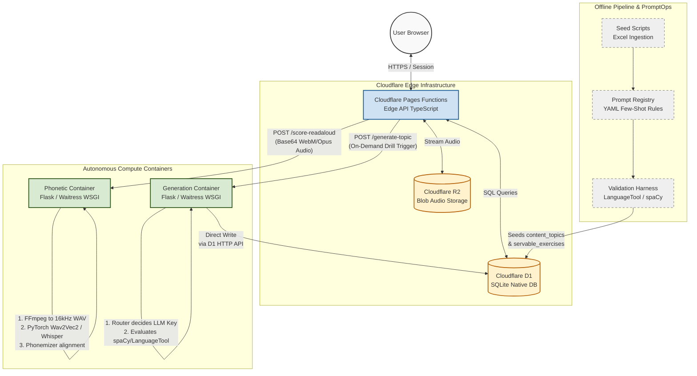

# 🇩🇪 Intelligent B2/C1+ German Learning Platform
[](#)
[](#)
[](#)

An enterprise-ready, decoupled, and highly cost-optimized platform for advanced German language acquisition (B2/C1+), tailored to accommodate users with ADHD and social anxiety via specific behavioral psychology evidence. 

The application utilizes an intelligent combination of **Serverless Edge Runtimes**, **Decoupled Python Compute Microservices**, **FinOps-driven LLM Routing**, and a **Strict Deterministic Validation Harness**.

---

## 🏗️ System Architecture & Data Flow

The platform separates fast, low-latency client state management from heavy NLP processing and machine learning inference. Serverless Edge Runtimes govern standard application loops, while microservices hosted on independent compute containers execute heavy PyTorch phonetic alignment and constrained text generation.



---

## ⚡ Key AI Engineering Highlights

### 1. FinOps Model Routing Strategy
To ensure optimal unit economics, the system features a runtime routing abstraction layer (`model_routing.py`). It protects profit margins by restricting expensive APIs to difficult edge cases:
* **Commodity Drills (Unscramble, Binary Choice):** Routed to highly cost-efficient, lightning-fast models like **DeepSeek-V3**.
* **Syntactic Weaknesses (Dative Prepositions, Funktionsverbgefüge):** Automatically escalated to **Gemini 2.5 Flash** due to known token-biases where smaller models consistently fail rule adherence.
* **Complex Transformations (Register Reformulation):** Routed to **DeepSeek-R1 (Reasoning)** to suppress structural imitation biases (~230s execution trade-off justified by strict alignment quality).

### 2. Deterministic Validation Harness (5 Gates)
Outputs generated by LLMs are treated as inherently untrusted. Before an exercise is flagged as `auto_ok` and promoted to production `servable_exercises`, it must clear a pipeline validation suite sequentially:
1. **Structural Integrity Check:** Guarantees that the generated string (`sentence_full`) contains the exact substring of the variable target (`gap_answer`).
2. **Morphological Rule Adherence:** Leverages **spaCy (`de_core_news_lg`)** parsing to inspect the `Case` feature of tokens immediately following gaps, validating linguistic accuracy against the curriculum schema.
3. **Orthographic Validation:** Runs **LanguageTool** checks locally over the complete string to identify semantic and grammar anomalies.
4. **Alternate Answer Exhaustion:** Reconstructs the sentence permutation iteratively with every alternative entry listed by the LLM, validating all variations against LanguageTool.
5. **Mechanical Repair Gate:** Automatically purges typos or low-confidence alternate tokens while preserving the core pristine exercise, optimizing data conversion metrics.

### 3. Isolated Phonetic & STT Containers
Audio content produced via microphone inputs (WebM/Opus) is processed at the serverless level and passed to containerized instances running **PyTorch, Wav2Vec2 (`facebook/wav2vec2-lv-60-espeak-cv-ft`), and faster-whisper**. 
* Phonetic similarity metrics use custom **`difflib.SequenceMatcher` alignment**, printing distinct visual feedback loops (Equal, Replace, Delete, Insert) down to the exact mismatch phoneme string.
* **Lexical and Phonetic separation:** Spaced repetition memory engines (FSRS) adjust scheduling entirely based on *lexical parameters* (if the correct word was spoken), ensuring accent variances do not break memory retention curves.

---

## 🗄️ Database Entity-Relationship Diagram (ERD)

The database layers decouple global immutable application data (curriculum topics, exercises, texts) from highly volative single-tenant progression parameters, ensuring high data durability in multi-user environments.


---

## 🛠️ Repository Engineering Standards

### Project Structure
```directory
├── .github/workflows/       # Automated CI/CD (Docker compilations, D1 migrations)
├── app/                     # Cloudflare Pages static frontend & TypeScript Worker Edge API
│   ├── functions/           # Core Edge routing middleware & FSRS logic
│   └── migrations/          # SQLite native transactional version control
├── pipeline/                # Python Data ingestion & Core LLM / NLP logic
│   ├── src/                 # Validation loops, spaCy processing, and R2 hooks
│   └── output/              # Data generation checkpoint registries
└── services/                # Decoupled microservices deployed to Cloudflare Containers
    ├── generation-container/# Waitress WSGI wrapper for on-demand generation tasks
    └── phonetic-container/  # Waitress WSGI wrapper for PyTorch / FFmpeg speech engines
```

### Static Analysis & Verification Guards
Local pipelines run automated code quality validations before pushing integration updates:

```bash
# Executing Python dead-code and structural isolation audits
vulture pipeline/ vulture_whitelist.py

# Verifying TypeScript Edge API compile targets
cd app
npx tsc --noEmit

# Inspecting frontend dependency layouts
npx depcheck .
```
