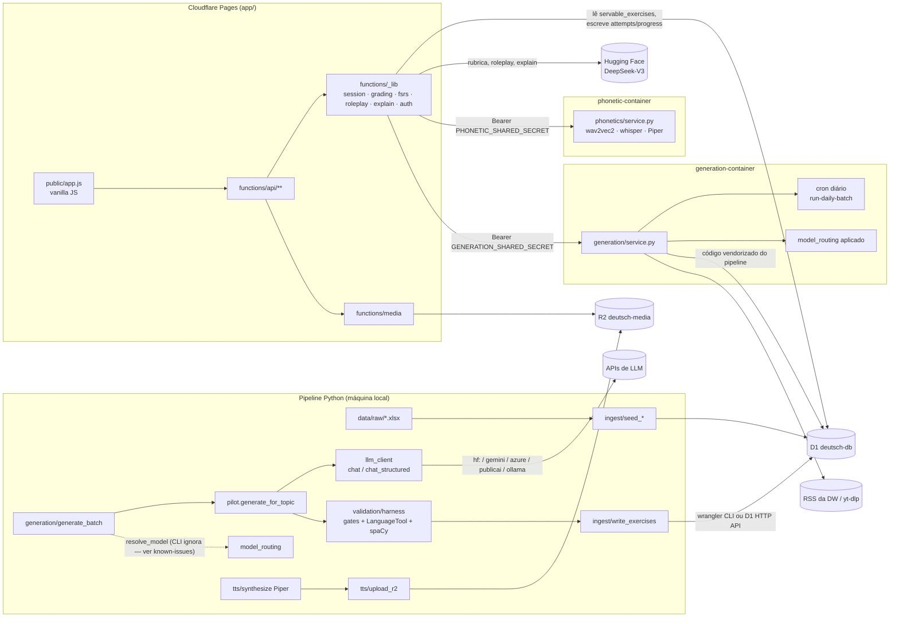

# Arquitetura

Três mundos: o **pipeline Python** gera e valida conteúdo em lote, fora do app; o **Worker do Cloudflare Pages** serve o app e grava estado do usuário; dois **Cloudflare Containers** rodam o que o Worker não consegue (inferência PyTorch, spaCy/LanguageTool). O D1 guarda conteúdo e estado; o app só lê exercícios pela view `servable_exercises`.

## Onde mexer

| Tarefa | Onde |
|---|---|
| Engine novo do Grupo A (geração) | `pipeline/.../generation/prompts_<engine>.py`; registrar em `ENGINE_PROMPTS` / `EXERCISE_FIELD_BUILDERS` / `ENGINE_SCHEMAS` (`generate_batch.py`); schema em `generation/schemas.py`; se o container usar, `services/generation-container/prepare-vendor.sh` |
| Validação de exercício | `validation/harness.py`, `rule_adherence.py`, `languagetool_check.py` |
| Provedor de LLM (pipeline) | `generation/llm_client.py` — `chat()` e `chat_structured()` têm listas de prefixo diferentes |
| Modelo forçado em tópicos fracos | `generation/model_routing.py` |
| Engine novo no frontend | `app/functions/_lib/types.ts`, `_lib/grading.ts`, renderizador e conjuntos de template em `app/public/app.js` |
| Composição de sessão / FSRS | `_lib/session.ts`, `_lib/fsrs.ts`, `_lib/progress.ts` |
| Feedback pós-tentativa | `_lib/explain.ts`, `functions/api/attempts.ts` |
| Roleplay / personas (Grupos B e D) | `_lib/roleplay.ts`, `api/hostile-roleplay/*`, `api/structured-speech/*`, `api/roleplay-voice/*` |
| Escrita aberta com rubrica | `_lib/llm.ts`, `_lib/opinionEssay.ts`, `_lib/quickOpinion.ts` |
| LLM dentro do Worker | `_lib/llmClient.ts` (só HF implementado) |
| Home, dashboard, hubs | `_lib/home.ts`, `categories.ts`, `dashboard.ts`, `readingBlocks.ts`, `videoGroups.ts` |
| Login / multi-usuário | `_lib/auth.ts`, `api/auth/*`, migration `0011_users.sql` |
| Schema do banco | nova `app/migrations/00NN_*.sql`, aplicada à mão com `wrangler d1 execute` |
| Correção fonética / STT / TTS ao vivo | `pipeline/.../phonetics/service.py` (o que roda), cliente `_lib/phonetics.ts` — não `services/phonetic-container/service.py` |
| Batch diário de vídeo/leitura | `video/daily_batch.py`, `generation/daily_reading_batch.py`, `generation/reading_sources.py`, loop/cron em `services/generation-container/src/index.ts` |
| Algo que o container precisa enxergar | `services/*/prepare-vendor.sh` + `COPY` no `Dockerfile` + `requirements.txt` do container |
| Deploy / CI | `.github/workflows/deploy-*.yml`, `verify.yml` |
| Variáveis de ambiente | `.env.example` (nomes), `app/.dev.vars`, secrets dos Workers |
| Bug conhecido / problema do wrangler local | `docs/known-issues.md`, `docs/local-dev-troubleshooting.md` |
| Leitura de exercícios no app | sempre pela view `servable_exercises` |
| Visual | `app/public/style.css` (tokens em `:root`; `@media` depois da regra base) |

## Pontos frágeis

- **Sem testes automatizados** em lugar nenhum. Mais arriscado sem rede: `grading.ts`, `harness.py`/`find_bad_alternates`, builders de campo por engine, `interleave`, `_clean_cell`.
- **CI fraco**: só o `tsc` bloqueia de verdade; não há lint nem typecheck Python.
- **Duas vias de escrita no D1** (Worker e container via HTTP API), com lógica dividida entre TS e Python.
- **`app.js` monolítico**, sem módulos nem testes.
- **Jobs de regeneração sem watchdog**; geração sob demanda pouco exercitada ponta a ponta em produção.
- **Ambiente local do wrangler** com D1/R2 divergentes entre `pages dev` e CLI (ver `docs/local-dev-troubleshooting.md`).
- **Bugs abertos** (schema fixo, roteamento no CLI, checkpoint, "Palavra do dia" fora de `servable_exercises`): `docs/known-issues.md`.
- **Dependências e variáveis de ambiente** espalhadas, sem fonte única.
- **Conteúdo que não passou do piloto**: `ReadAloudEngine`/`SpokenGapFillEngine` com 1 exercício cada; a playlist da DW usada no batch diário esgota em poucas semanas.
